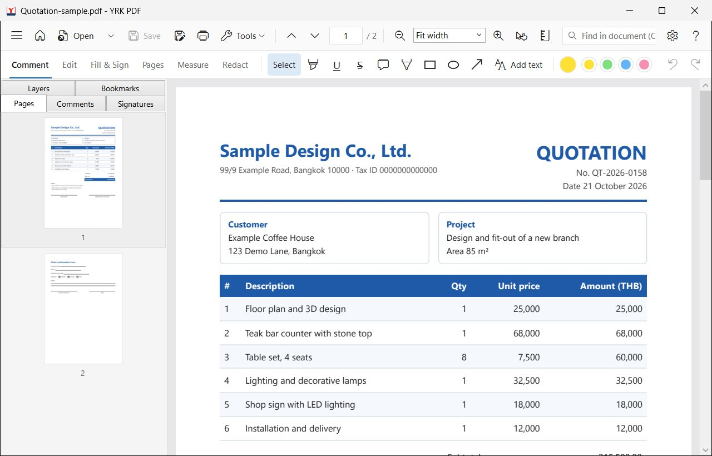
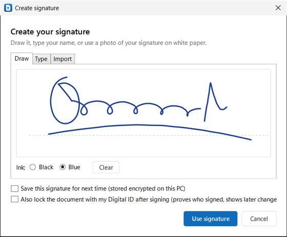
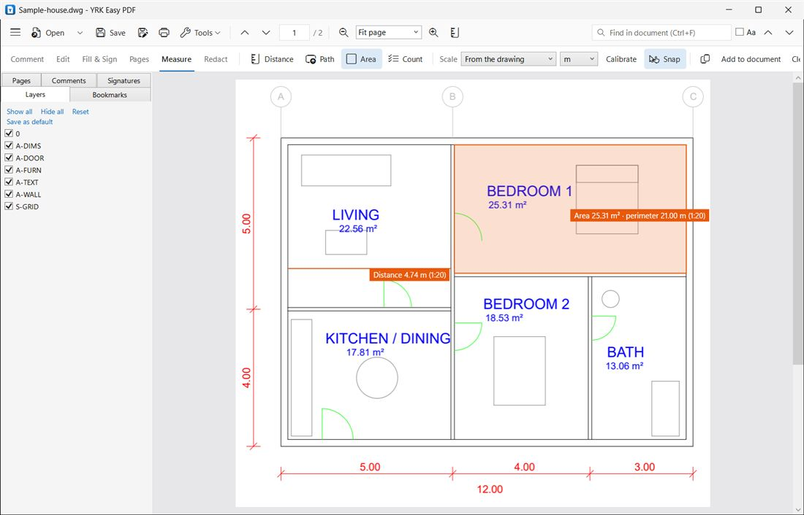
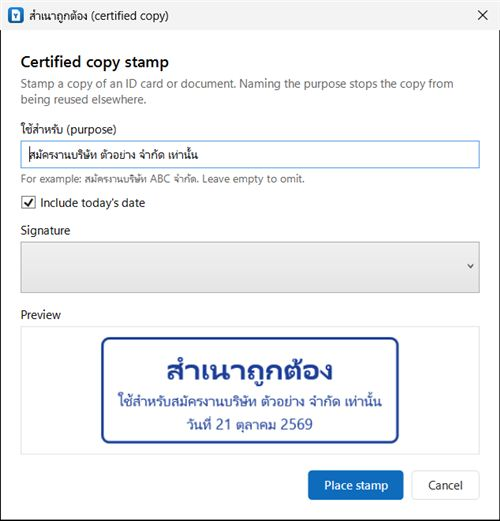

# YRK PDF

A free PDF reader and editor for Windows, made in Thailand by **YRK**. Read, fill in and sign PDFs,
organise pages, convert PDF to Word, Excel and PowerPoint, recognise scanned text (Thai and English), and
open AutoCAD drawings (DWG/DXF), all on your own computer. Every feature is free, also for business use,
with no ads, no account and no tracking. The interface is in Thai and English. (Formerly YRK Easy PDF.)

**Download:** [yr-ken426.github.io/yrk-easy-pdf-release](https://yr-ken426.github.io/yrk-easy-pdf-release/)
(installer or portable zip, Windows 10/11 x64). The current version is in
[Directory.Build.props](Directory.Build.props); release notes are in [docs/release-notes](docs/release-notes).

| | |
|---|---|
|  |  |
|  |  |

### Highlights

- **Thai documents done right:** Thai text is shaped correctly when you type, edit or fill in forms;
  PDF to Word/Excel repairs the Thai text that many PDFs store badly; OCR reads Thai scans; the
  "สำเนาถูกต้อง" (certified true copy) stamp takes one click
- **Signing:** handwritten signatures kept as sharp vector outlines, and PAdES digital signatures with
  Windows certificates, smart cards, USB tokens or .pfx files, with an optional trusted timestamp
- **Drawings:** open .dwg and .dxf files directly, switch layers, measure at scale and compare revisions
- **Offline:** documents never leave the computer and are never sent to an AI or cloud service. The
  program uses the internet only to check for updates (can be turned off), to download an OCR language
  the first time it is needed, for an optional signing timestamp, and when Windows checks whether a
  signer's certificate was revoked. The details are on the program's "Privacy and safety" page

### How it is made

YRK PDF is written in C# (.NET 10, WPF) on top of PDFium and other open-source components with
permissive licenses (see [THIRD-PARTY-NOTICES.md](THIRD-PARTY-NOTICES.md)).

The code is developed with the help of AI coding tools (Claude Code by Anthropic). The maintainer
decides what to build, reviews the changes, tests them on real documents and in the installed program,
signs and publishes the releases, and answers bug reports. The program itself contains no AI features and
sends nothing to AI services: the "No AI" on the website is about how the program treats your documents.

Bug reports and ideas are welcome, see [CONTRIBUTING.md](CONTRIBUTING.md); security problems go through
the private channel in [SECURITY.md](SECURITY.md).

## Features

### Start page and everyday tools

- **Start page** with a card for each job (organise, convert, edit and sign, drawings, security): click a
  card, choose a file, and the tool opens. Switch between Thai and English there; the Home button and a
  new tab bring it back
- **Hand tool:** hold Space, press H, or drag with the middle mouse button to move around a zoomed page
- **One font bar** for all typed text (added text, form fields, edited lines): font, size, bold, italic
  and colour; watermarks, headers, footers and page numbers can use any installed font too
- Menus: Tools, ⚙ Settings (language, updates, privacy) and ? Help (common questions, suggestions and problems, About)

### Reader

- Open PDFs from the Open dialog, by drag and drop, or from the command line / "Open with"
- **Tabs:** each file opens in its own tab (Open, dropping several files, or "Open with" while the app
  runs: one window only). Ctrl+Tab / Ctrl+Shift+Tab or Ctrl+PageDown / PageUp switch tabs, Ctrl+W or
  middle-click closes one, and closing the window asks about every tab with unsaved changes
- **Export** (Tools ▸ Export, or the start page cards): **Word** (.docx: paragraphs with fonts, sizes,
  bold and colour at the PDF's line spacing, real Word tables with merged cells, borders and shading,
  pictures and charts where they were, footers; scanned pages go in as pictures), **Excel** (.xlsx:
  tables with merged cells, borders and fill, numbers stored as numbers with their format such as
  1,250.00 or 3.0%, one sheet per page or all on one), **PowerPoint** (.pptx, one picture slide per
  page), **PNG / JPG** images at 72–600 dpi, and **plain text**. Thai text that PDFs store badly (stray
  spaces before vowels, wrong "ำ") is repaired. All pages, the current page or a range. Done on this
  computer only
- **Save as PDF/A** (Tools, for archiving): a PDF/A-2b copy (ISO 19005-2), the format archives and
  government bodies ask for. Fonts that are missing from the file are embedded from Windows (Helvetica,
  Times and Courier as the metric-compatible Arial, Times New Roman and Courier New), an sRGB colour
  profile and matching XMP metadata are added, scripts, attachments, hidden comments and now-invalid
  signatures are removed, and the list of changes is shown. When something can only be fixed by changing
  how the document looks (a font that is not installed, CMYK colour, a form field without an appearance),
  nothing is written and the reasons are listed, so a file is never labelled PDF/A when it is not.
  Checked with veraPDF: every converted test file passes PDF/A-2b
- **Process many files** (Tools): one job for a list of PDFs or a whole folder (with subfolders): save
  as PDF/A, compress, watermark/header/footer/page numbers, password, or export. The originals are never
  changed; results go to the chosen folder (" (PDF-A)", " (compressed)"… added to the names, never
  overwriting). Files that cannot be done (password needed, restricted, not convertible) are skipped and
  listed with the reason; Cancel stops after the current file
- Password-protected documents
- Continuous scrolling, zoom (fit width, fit page, presets, Ctrl + mouse wheel), sharp on high-DPI screens
- Page thumbnails and bookmarks (outline) sidebar
- Find in document with highlighted results (Thai and other Unicode text)

### Fill & Sign

- **Fill PDF forms:** text fields, check boxes, radio buttons and drop-downs are editable on the page;
  PDFium writes the values and regenerates each field's appearance
- **Create forms** (Fill & Sign › Create form): text boxes (one line or several), check boxes, dropdown
  lists and signature fields. Drag a box on the page (or click for the usual size), give the field a name
  (and the choices of a dropdown, or "must be filled in"). New fields show as blue dashed boxes with an ×
  until saved; Ctrl+Z undoes, Esc puts the tool down. They are written as standard AcroForm fields with
  their own appearance, so Acrobat and other readers show and fill them (Thai included); the update is
  appended, so existing digital signatures stay valid
- **Edit fields** (Create form › Edit fields): click any field, new or already saved, to rename it,
  change a dropdown's choices or "must be filled in", or delete it (out of the form, not only off the
  page). Pending changes show orange, deletions red with a cross, until saved
- **Electronic signature, kept sharp:** draw it with mouse, pen (the line follows pen pressure) or
  touch, or type your name in a handwriting font; both are written into the PDF as **vector outlines**,
  so they stay crisp at any zoom and in print. **Import** a signature as SVG or PDF (stays vector; a PDF
  is cropped to its ink) or as a PNG/JPG photo (the paper background is removed).
  Saved signatures are encrypted with Windows DPAPI under `%LOCALAPPDATA%\YRK\EasyPdf\Signatures`
- **Sign and lock:** tick "Also lock the document with my Digital ID" and, after placing the handwritten
  signature, the digital-signature step follows (invisible by default), so the file shows who signed and
  any later change
- **Add text** anywhere on the page, for example on scanned forms: saved as **real text** (searchable,
  copyable, Thai shaped correctly, font subset embedded)
- **สำเนาถูกต้อง stamp** (certified true copy) with an optional purpose line
  ("ใช้สำหรับ… เท่านั้น"), today's date in Thai, and your signature
- Move, resize (keeping proportions) and delete placed items; undo and redo
- **Save** keeps existing digital signatures valid: changes are appended as an incremental update,
  written to a temporary file first, and swapped in only when complete. **Save a copy** writes elsewhere
- Prompts to save unsaved changes before closing or opening another file
- Errors are logged to `%LOCALAPPDATA%\YRK\EasyPdf\logs`

### Page tools

- **Rotate, delete, insert pages from another PDF, extract pages** for the current page or several
  pages selected in the sidebar (Ctrl/Shift-click). Right-click the thumbnails for the same commands
- **Reorder pages** by dragging thumbnails. Rotating and moving can be undone
- **Split** a PDF into several files: every N pages, or by ranges such as `1-3, 4, 5-`
- **Combine files** into one PDF, in the order you choose
- **Images to PDF:** photos, scans and screenshots, one image per page on A4, Letter or image-sized
  pages. JPEGs are embedded without re-compression; phone photos are turned upright using EXIF
- **Compress PDF** with three presets (150 / 96 / 220 dpi). Writes a new copy and reports the saving;
  bookmarks, links and forms are kept
- Combine, Images to PDF and Split never change the original files

### Comment

- **Select text** (the default tool): drag over text, then Ctrl+C to copy, or right-click to highlight,
  underline or strike it out
- **Highlight, underline, strikeout** by dragging over text; highlights are clean bands, one per line
- **Sticky notes** with comment text (Thai included); a new note opens its text box in the Comments panel
- **Pen** (freehand), **rectangle**, **ellipse** and **arrow**, in six colours and three line widths
- **Comments panel**: every annotation in the file, also those made in other apps, with page, author
  and date. Click one to jump to it, edit its text in place, or delete it
- Annotations are standard PDF annotations with appearance streams, so Acrobat, browsers and phone
  viewers show them; each has a unique id (/NM). Adding annotations can be undone and redone
- The secondary toolbar is now three tabs: Comment, Fill & Sign and Pages

### Digital signatures

- **Sign with a digital ID** (Fill & Sign › Digital ID): PAdES signatures (`ETSI.CAdES.detached`,
  baseline B-B, or B-T with a timestamp) that prove who signed and reveal any later change
- **Digital IDs from anywhere:** certificates in the Windows store, smart cards and USB tokens from
  certificate authorities (Windows asks for the PIN), or password-protected .pfx/.p12 files. Device and
  sign-in certificates (Wi-Fi, VPN, work accounts) are left out of the list
- **Create a self-signed digital ID** (RSA 3072) for internal use, kept as a .pfx in
  `%LOCALAPPDATA%\YRK\EasyPdf\DigitalIDs`
- **Visible or invisible:** drag a box on the page (or click for the default size). The appearance shows
  your handwritten signature or your name, plus "Digitally signed by", the date and the reason (Thai works)
- **Trusted timestamp** (RFC 3161) from a server of your choice; DigiCert's free server is the default
- **Signing never touches the original bytes:** the signature is appended as an incremental update,
  so earlier signatures stay valid and you can sign a document several times
- **Signatures panel and status bar:** every signature is checked when a file opens: integrity, the
  signer's certificate chain, expiry, revocation (OCSP/CRL, online) and timestamp. It says when a
  document was changed after a signature, and **View signed version** opens exactly what was signed
- **Certificate** opens the Windows certificate details window

### OCR, redaction and text editing

- **Recognize text (OCR)** (Edit tab, or Tools): makes scans searchable and copyable with Tesseract 5
  (Thai, English and nine more languages). The text goes in an invisible layer, so pages look exactly the
  same. Only pages without text are processed unless you choose all pages. Language data (1–5 MB per
  language) is downloaded once from the Tesseract project when first needed; progress shows with Cancel
- **True redaction** (Redact tab): drag over anything, or mark every place a word or ID number appears
  (search box › Mark search results), then Apply redactions. The marked text, drawings, annotations and
  form fields are removed from the file, not just covered; the rest of the line keeps its exact position.
  Pages where an image lies under a mark (scans) become images with the areas blacked out. PDFium checks
  the result before it is saved, and the file is rewritten without earlier versions, so removed content
  cannot be recovered. The result is always a new file
- **Edit text** (Edit tab): click a line, type, press Enter; the line is replaced when you save. New text is
  real text in an embedded font subset, shaped by Windows (Thai vowels and tone marks placed correctly), in
  the document's own font when it is installed (otherwise Leelawadee UI), with the original size and colour.
  Copy and search read it correctly, also lines with stacked Thai marks such as น้ำ or ที่
- The secondary toolbar now has five tabs: Comment, Edit, Fill & Sign, Pages and Redact

### Drawings and layers

- **Layers panel** (sidebar › Layers): PDFs exported from AutoCAD, Illustrator, InDesign or Visio keep their
  layers. Tick or untick a layer (or a heading for its whole group), Show all / Hide all / Reset. Locked
  layers stay as the author set them. The file is not changed, unless you choose **Save as default**, which
  makes the current visibility the one the file opens with (applied when you save)
- **Open AutoCAD drawings (.dwg, .dxf)** directly, without AutoCAD: AutoCAD R14 to 2018+ formats
  (ACadSharp). The model space becomes a vector PDF page at a standard scale (1:1 … 1:100000, fitting A0),
  with one layer per AutoCAD layer (layers that are off or frozen start hidden), AutoCAD colours (white is
  drawn black), lineweights, linetypes, blocks (with arrays and attributes), dimensions, hatches (solid and
  patterns), splines, ellipses, leaders and text. Text is real, searchable text: SHX fonts use Arial,
  TrueType fonts use the installed font, Thai uses AngsanaUPC/Cordia when installed (otherwise Leelawadee
  UI). The page carries the scale for measuring (PDF measure dictionary). **Save** stores it as a PDF next to
  the drawing; the drawing itself is never changed
- **Layouts (paper space)** become extra pages after the model, at 1:1 on the paper, with a bookmark per
  layout: title block and notes as drawn, each viewport showing the model at its own scale, cut to its
  frame, without the layers frozen in it. Measuring inside a viewport uses that viewport's scale (1:50,
  1:10, …); elsewhere on the sheet, paper millimetres. Viewport frames are drawn unless their layer does
  not plot (Defpoints)
- **Illustrator files (.ai)** saved with "Create PDF Compatible File" open like PDFs
- **Sharp at any zoom:** zoom now goes to 6400 %, and at high zoom the visible part of the page is rendered
  separately at full resolution, so small text in drawings stays crisp
- "Open with" in Explorer also lists YRK PDF for .dwg, .dxf and .ai files
- **Measure** tab: **Distance** (drag; Shift snaps to 45°), **Path** (click points) and **Area** (click
  corners; area and perimeter); double-click or Enter finishes, Esc cancels. The scale comes **from the
  drawing** (the PDF's measure dictionary, written by AutoCAD and by our DWG converter; AutoCAD leaves out
  the unit, so its numbers are read in the chosen unit), from a preset 1:1 … 1:1000, or from **Calibrate**
  (drag over a known dimension and type its length). Units mm, cm, m, in, ft. Results stay on screen in
  orange; Copy, **Add to document** (as comments with the value) or Clear
- **Count** (Measure tab): click each item on a drawing (doors, sockets, lights…) to drop a numbered dot;
  click a dot again to remove it. Several **types**, each with its own colour and name; the totals show
  as you go ("Door 12 · Window 8 · Total 20"). **Copy** the list (pastes into Excel as a table), **Save
  list** as an Excel workbook (totals per type and page, plus every item with its position), or **Add to
  document** as small coloured circles whose comment is "Door 3"
- **Snap** (on by default): measure points jump to line ends (green square) and middles of straight
  lines (green triangle) within a few pixels, including lines inside CAD blocks; Shift gives 45° steps
  instead
- **Rulers** (toolbar button or Ctrl+R) along the top and left of the page view, starting at the page's
  corner, in the same units and scale as measuring (mm on paper, or the drawing's units at its scale),
  with the mouse position marked. Click the unit in the rulers' corner to switch unit (mm, cm, m, in, ft,
  pt) or scale; the unit is remembered for next time
- **Compare two revisions** (Tools › Compare with another version…): pick another PDF, DWG/DXF or AI.
  Each page of both versions is rendered at the same size; ink only in the open file is red, only in the
  other file blue, unchanged grey. A list of changed areas zooms to each one; views Differences / first /
  second, Swap, Page Up/Down, Ctrl+wheel zoom. Also from the command line:
  `YrkEasyPdf.exe old.pdf --compare new.pdf`

### Print

- **Print** (Ctrl+P or the printer button): printer, paper size (from the printer), orientation (Auto
  follows the first page), copies and collate, pages (all, current, or a range like 1-3, 5)
- **Size:** fit to paper, **actual size** (keeps a drawing's scale on the right paper), shrink oversized
  pages, or a custom percentage; landscape pages are turned to fit portrait paper (and the reverse)
- **Output:** black and white, with or without comments, quality Draft 150 / Standard 300 / High 600 dpi
  (very large sheets are capped at 80 MP per page)
- A preview shows each page on the paper with the printer's margins. What is shown is printed: hidden
  layers stay hidden; signatures, text and form entries not yet saved are printed after saving (the app
  offers to save first). Printing runs in the background with progress and Cancel

### Watermark, header, footer and page numbers

- **Tools › Watermark, header and page numbers…** with a live preview of each page:
  - **Watermark:** any text (e.g. "CONFIDENTIAL", "สำเนา"), fitted to the page or a set size, grey/red/
    blue/black, opacity 5–100 %, angle 45°/0°/−45°/90°, behind or over the page content
  - **Header and footer:** left, centre and right on each, with {page}, {pages}, {date} and {file};
    one-click page numbers ("1", "1 / 10", "Page 1 of 10", "หน้า 1 จาก 10", "- 1 -"), text size,
    colour, margin, first number, and skipping the cover page
- Everything is written as **real text** (searchable, Thai shaped correctly) into a new copy;
  the settings are remembered until the app closes

### Password protection

- **Tools › Protect with password…** encrypts a copy with **AES-256** (PDF 2.0 / Acrobat X+ standard):
  a password to open, restrictions with an owner password, or both. Restrictions choose what others may
  do: print, copy text and images, fill in forms and sign, add comments, change the content, and
  insert/delete/rotate/extract pages (screen readers can always read). Digital signatures in the copy
  are removed
- **Tools › Remove password protection…** saves an unprotected copy (needs the owner password when the
  file has restrictions)
- **Other people's restrictions are respected:** printing (low quality only when the author allows only
  that), copying text, saving changes, page tools, OCR, redaction, compression and signing check the
  file's permissions; when something is not allowed the app explains it and asks for the owner password,
  and with the right one reopens the file with full rights

### Thai and English menus

- The whole interface (menus, toolbars, dialogs, messages, status bar) is in **Thai or English**. The
  first start follows the Windows display language; **Tools › Language / ภาษา** switches at once,
  without restarting, and the choice is remembered
- Translations live in `src/Yrk.PdfStudio.App/Localization/th.json` (English text → Thai). After adding
  UI text, `powershell -File build\check-translations.ps1` lists texts that still need Thai

### Installer and updates

- **Setup.exe** installs for the current user without administrator rights (to
  `%LOCALAPPDATA%\YRK.EasyPdf`), with Desktop and Start menu shortcuts and an uninstall entry. It installs
  the Visual C++ runtime that OCR needs when it is missing (that one step asks for administrator rights)
- **Portable zip:** unzip and run `YRK PDF.exe`; it changes nothing in Windows and updates itself too
- **Automatic updates, by choice:** on first start the app asks whether it may check for updates; nothing
  goes out before the answer. When allowed, about 20 seconds after start it checks the update feed,
  downloads a newer version in the background (small delta packages, SHA-256 checked) and shows "Restart
  to update"; nothing is installed until that is clicked. The switch is in Tools › Privacy and safety and
  in About, which also checks on demand
- **Open with:** installing registers YRK PDF for PDF files under "Open with" and in Settings ›
  Default apps, without taking over the current default viewer. Uninstalling removes all of it
- **About** shows the version, update settings and the open-source licenses
- **Privacy and safety** (Tools menu) says plainly what the app does with data: offline, no AI, no tracking,
  the three cases where it uses the internet (update check, OCR language download, optional signature
  timestamp), what it keeps on the computer; with Clear recent files and Open the data folder
- **Recent files:** the start screen lists the last 12 files (click to open, in a new tab when one is
  open), and the arrow next to Open shows the same list. Files that are gone are taken off when clicked.
  Kept in `%LOCALAPPDATA%\YRK\EasyPdf\recent.json` (paths only); converted drawings' temporary PDFs are
  not listed
- The app has its own icon (redraw it with `build\make-icon.ps1`)

### Keyboard shortcuts

| Keys | Action |
|---|---|
| Ctrl+O / Ctrl+W | Open / close |
| Ctrl+F, F3, Shift+F3 | Find, next result, previous result |
| Ctrl+Plus / Ctrl+Minus | Zoom in / out |
| Ctrl+0 / Ctrl+1 / Ctrl+2 | Fit page / actual size / fit width |
| Ctrl+Home / Ctrl+End | First / last page |
| Ctrl+S / Ctrl+Shift+S | Save / save a copy |
| Ctrl+P | Print |
| Ctrl+Z / Ctrl+Y | Undo / redo (placed signatures, stamps and text) |
| Delete / Esc | Remove the selected item / cancel placing |
| Double-click text | Edit a text box you added |
| Del (in the page sidebar) | Delete the selected pages |
| Ctrl+C | Copy the selected text |
| Del / Esc (comment selected) | Delete the selected annotation / clear the selection |
| Enter / Esc (editing a line) | Keep / drop the change |

## Build and run

Requirements: Windows 10 or 11 and the [.NET 10 SDK](https://dotnet.microsoft.com/download/dotnet/10.0).

```bash
dotnet build YrkPdfStudio.slnx
dotnet run --project src/Yrk.PdfStudio.App
```

You can also open `YrkPdfStudio.slnx` in Visual Studio 2022 (17.14 or later) or JetBrains Rider.

Run the tests (they use `tests/Assets/sample.pdf`, printed from `sample.html` with Edge, and generate
form PDFs on the fly; `tests/Assets/form.pdf` is a copy for trying Fill & Sign by hand):

```bash
dotnet test YrkPdfStudio.slnx
```

## Releasing

`build\release.ps1` runs the tests, publishes a self-contained win-x64 build (ReadyToRun) and packages it
with [Velopack](https://velopack.io) (`vpk`, a local .NET tool: run `dotnet tool restore` once). Output goes
to `artifacts\releases\win-x64`: `YRK.EasyPdf-win-Setup.exe`, `YRK.EasyPdf-win-Portable.zip`, and the
update feed (`releases.win.json`, `*-full.nupkg`, `*-delta.nupkg`).

```bash
powershell -ExecutionPolicy Bypass -File build/release.ps1 -UpdateUrl https://downloads.example.com/pdfstudio
```

- **Version:** from `Directory.Build.props`, or `-Version 1.2.3`.
- **Update feed:** upload the whole folder to `-UpdateUrl` (any static web host, or a
  `https://github.com/<owner>/<repo>` URL for GitHub Releases). Keep earlier packages there, so the next
  build can make deltas. Without `-UpdateUrl` the build does not check for updates. To try an update
  locally, use a folder path as `-UpdateUrl`, or set `YRK_PDFSTUDIO_UPDATE_URL` before starting the app.
- **GitHub Releases** (download page and update feed in one): the repository must be **public** (people
  download without an account), for example the separate `YR-KEN426/yrk-easy-pdf-release` repository with only
  releases in it. Installed copies look for updates there, so releases stay in that repository even
  though the source is published separately.
  `-GitHubRepo owner/name` builds with that address and first fetches the previous release (for deltas);
  add `-Publish` to upload and publish it, with a fine-grained token in `GITHUB_TOKEN` that has
  "Contents: read and write" on that repository only:

  ```bash
  powershell -ExecutionPolicy Bypass -File build/release.ps1 -GitHubRepo YR-KEN426/yrk-easy-pdf-release -Publish
  ```
- **Signed updates (YRK's own key):** an installed copy accepts an update only when the package's SHA-256,
  version and name are signed (ECDSA P-256) by the private key matching the public key built into it
  (`src/Yrk.PdfStudio.App/Assets/update-public-key.pem`). So whoever controls the download site still
  cannot ship a fake update. Velopack's own start-up install is switched off; the downloaded package is
  checked, deleted if it fails, and installed only on "Restart to update". Create the key **once**:

  ```bash
  dotnet run --project build/UpdateSigner -- new-key --private "%USERPROFILE%\YRK-keys\update-signing-key.pem" --public src/Yrk.PdfStudio.App/Assets/update-public-key.pem
  ```

  The private key file is encrypted with the password chosen there (at least 12 characters). Back up the
  file and the password separately: without them, installed copies can never be updated again (people
  would have to reinstall a build with a new key). Commit only the public key. Every release build with
  an update address asks for the password once, checks the key against the app's public key before
  building, writes `YRK.EasyPdf-<version>.sig`, and with `-Publish` adds it to the draft release before
  publishing it.
- **Code signing** (strongly recommended, or SmartScreen warns about Setup.exe):
  - `-SignPfx cert.pfx` with the password in `YRK_SIGN_PFX_PASSWORD`. This signs with PowerShell, so no
    Windows SDK is needed, and timestamps with DigiCert unless `-NoTimestamp`.
  - `-AzureTrustedSigningMetadata metadata.json` for Azure Trusted Signing (about USD 10 a month; the
    simplest choice for a company in Thailand once identity validation is done).
  - Since 2023, OV/EV certificates come on a hardware token or in a cloud HSM, so a .pfx file is mainly
    for testing. With a token, sign through `signtool` by setting `VPK_SIGN_PARAMS` instead.
- **Tested** (with a self-signed test certificate and a local feed): silent install, signed files,
  "Open with" registration, OCR in the installed copy, update 0.1.0 → 0.1.1 by delta and restart,
  portable copy, and an uninstall that leaves no files, shortcuts or registry entries.

## Known issues

- **PDF to Word:** Word wraps lines with its own Thai dictionary and fonts; where it ends a line earlier
  than the PDF did, or a table cell's text needs one more line, a page can run onto the next (a 22-page
  Thai report becomes 24 Word pages). Fonts that are not installed are replaced by Word's choice.
- **Drawings (.dwg/.dxf):** layout viewports are cut to rectangles (polygonal clip boundaries are not
  followed), 3D views in viewports are skipped, and model text in a viewport is kept only when it starts
  inside the frame (text is not cut). External references (xrefs) and raster images are not loaded, and multileaders, tables, wipeouts,
  3D solids and regions are not drawn (the status bar lists what was skipped). MText formatting inside the
  text (font, colour, height changes, stacked fractions) and automatic line wrapping are ignored. SHX fonts
  are replaced by TrueType fonts, so text widths differ slightly from AutoCAD. Lineweights are always shown.
- **Layers:** Photoshop does not export its layers as PDF layers, so Photoshop PDFs show none. Layers are
  shown and hidden on screen and in print; OCR and redaction use the document's own default visibility.
- **Print:** pages are sent as images at the chosen resolution (not as vectors), so very fine lines on
  large sheets depend on the quality setting. Printer-specific options (trays, duplex) use the printer's
  own defaults.
- **Measure and compare:** snapping finds line ends and middles, not intersections, circle centres or
  points on a line, and also snaps to lines on hidden layers. Comparing is visual (pixels at up
  to 3 px per point), so a change smaller than about half a pixel, or a pure colour change of the same
  darkness, is not found; pages are matched by number, and a page of a different size is stretched to the
  first. Unsaved changes in the open file are not included (the saved file is compared).
- **Thai text in form fields:** what the app writes into a field is drawn in an embedded font, and a form
  with Thai fields also gets the whole Sarabun font, named in those fields' /DA, for viewers that redraw a
  field while someone edits it there. Viewers built on PDFium (Chrome, Edge) still use a Windows Thai font
  of their own for that, and Thai typed elsewhere is not shaped (marks may sit a little off). In Adobe
  Acrobat a space typed after a Thai word still shows as "•" while editing (cause not found yet).
- **Fill & Sign:** the สำเนาถูกต้อง stamp's words are real text, but its frame and signature are saved as a
  picture (300 dpi). Added text becomes
  an image instead of real text in password-protected files, and when a page tool (rotate, delete,
  extract, split) runs before saving. SVG import covers shapes, strokes, colours and transforms, not
  text, gradients or masks.
- **Upside-down (180°) pages:** PDFium extracts their text in a different order, so search often misses
  words there (rotations of 90° and 270° work).
- **OCR:** quality depends on the scan (300 dpi, straight pages work best). Tesseract's native libraries
  are x64/x86 only (no Windows on ARM yet) and need the Microsoft Visual C++ runtime. Setup installs it;
  the portable copy needs it installed already (most PCs have it).
- **Redaction:** pages whose marked text uses Type 3 fonts, vertical writing or fonts without width
  tables are turned into images rather than edited. Text that is not on the page itself is not searched:
  bookmarks, document properties and tagged-PDF alternate text may still mention a redacted word. A path
  that only partly lies under a mark (a table line, for example) stays, covered by the black box.
  Password-protected PDFs cannot be redacted yet.
- **Text editing** works one line at a time and does not reflow paragraphs. A line in a font without
  exact measurements (see redaction) cannot be edited. Lines with stacked Thai marks are drawn as glyph
  outlines over invisible text (it looks the same and copies correctly, but other editors see shapes).
  Page tools ask you to save pending text changes first.
- **Digital signatures:** long-term validation data (PAdES B-LT/B-LTA: a DSS with OCSP responses and
  CRLs) is not embedded yet, so validation years later relies on the timestamp and the CA still
  answering. Certifying signatures (DocMDP) cannot be created yet. Password-protected PDFs cannot be
  signed. After a signature, the panel says that later changes exist but does not yet judge whether they
  were allowed (form filling and comments are). Signatures have not yet been checked in Adobe Acrobat
  or the EU DSS validator.
- Checking revocation contacts the certificate authority named in each certificate (as Acrobat does).
- Electronic signatures (Fill & Sign › Sign) are images; use Digital ID for a cryptographic signature.
- **Bookmarks of deleted pages stay in the outline** without a target (PDFium cannot edit outlines).
- **Combining or inserting PDFs with form fields** copies the fields' appearance but not the form
  itself, so those fields are no longer editable in the result.
- Existing annotations cannot be moved or resized yet, and deleting one cannot be undone (adding can).
- Colour dots in the Comments panel use a default per type for annotations that already have an
  appearance stream (PDFium does not report their colour).
- Compression only rewrites 8-bit grey/RGB images; CMYK, 1-bit scans (CCITT/JBIG2) and JPEG 2000 are kept
  as they are. Compressed copies lose existing digital signatures (the file is rewritten).
- **Installer:** releases are win-x64 only (about 78 MB, as .NET is included). Releases are not yet signed
  with a real code-signing certificate, so SmartScreen will warn until one is set up. There is no
  machine-wide MSI yet (vpk can make one with `--msi`). Uninstalling keeps the user's own data in
  `%LOCALAPPDATA%\YRK\EasyPdf` (saved signatures, digital IDs, OCR language files, settings, logs).

## Project layout

```
src/
  Yrk.PdfStudio.Core/   Engine-independent PDF API (IPdfEngine) and the PDFium implementation;
                        Pdf/Cos (PDF objects, incremental and compact writers, content streams),
                        Pdf/Signatures (PAdES), Pdf/Ocr (Tesseract), Pdf/Redaction, Pdf/Text (text writer),
                        Pdf/Layers (optional content), Pdf/Cad (DWG/DXF to PDF),
                        Pdf/Measure (page scales), Pdf/Compare (visual diff)
  Yrk.PdfStudio.App/    WPF application (MVVM): views, view models, services
docs/
  ARCHITECTURE.md       Architecture, ISO 32000 mapping and roadmap
```

See [docs/ARCHITECTURE.md](docs/ARCHITECTURE.md) for the design and roadmap, and
[THIRD-PARTY-NOTICES.md](THIRD-PARTY-NOTICES.md) for open-source licenses.

## Support

YRK PDF is free for everyone, including businesses, and will stay that way, with every feature. If it saves you
time, you can support its development through [GitHub Sponsors](https://github.com/sponsors/YR-KEN426).
Sponsorship pays for a code-signing certificate and development time. Thank you!

## Contributing, security and license

- Bug reports, ideas and pull requests: [CONTRIBUTING.md](CONTRIBUTING.md)
- Security problems (please report privately): [SECURITY.md](SECURITY.md)
- YRK PDF's own code is licensed under the [Apache License 2.0](LICENSE), see also [NOTICE](NOTICE).
  You may use, change and redistribute it, also commercially; the names "YRK" and "YRK PDF" and the icon
  are not part of the license, so modified versions need their own name and icon. Third-party
  components keep their own licenses, listed in [THIRD-PARTY-NOTICES.md](THIRD-PARTY-NOTICES.md) with
  full texts in [licenses](licenses).
